# RAG Test Harness: Technical Diagrams

Mermaid diagrams for the talk and the repo. Source of truth: `docker-compose.yml`, `packages/backend/app/main.py`, `services/chat.py`, `services/eval_run.py`, `services/sweep.py`, and `docs/features.md`.

## 1. System architecture

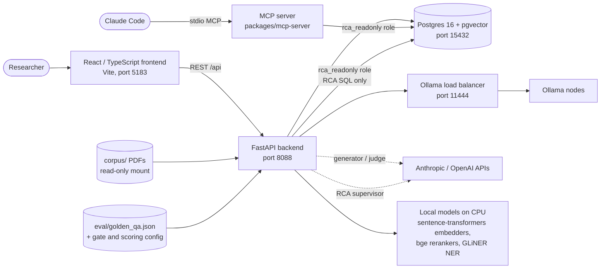

## 2. Docker Compose services

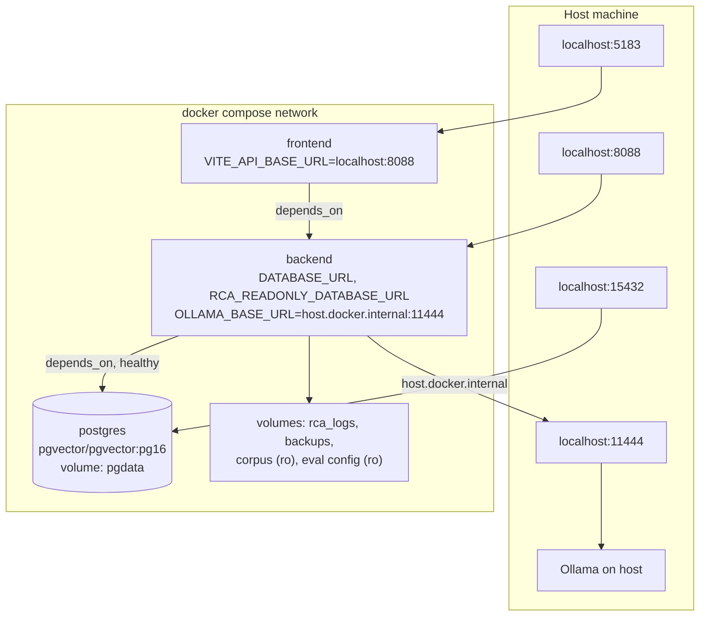

## 3. Ingestion

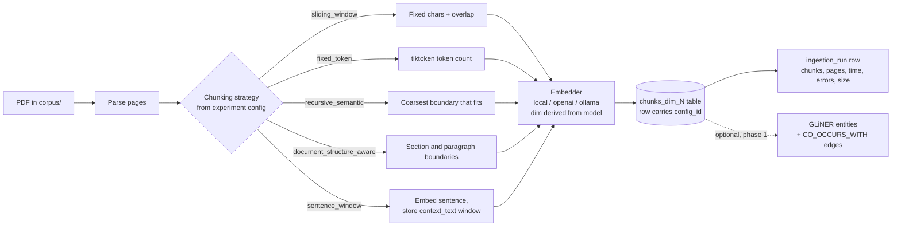

## 4. Chat retrieval pipeline

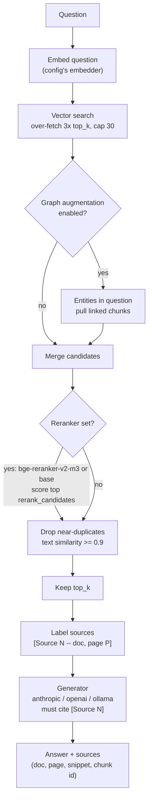

## 5. Eval cycle

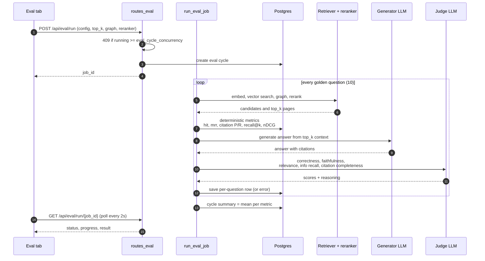

## 6. Metrics map

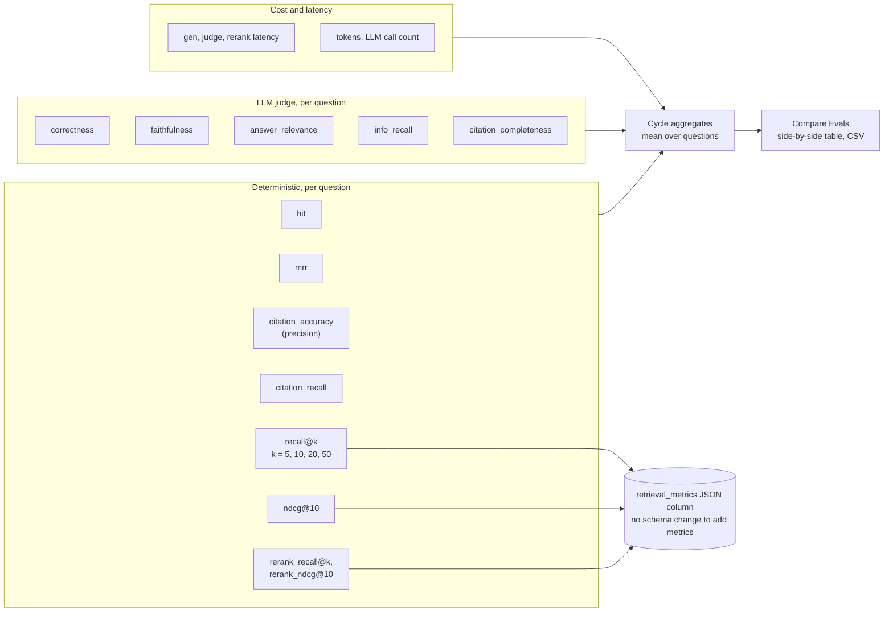

## 7. Sweep loop

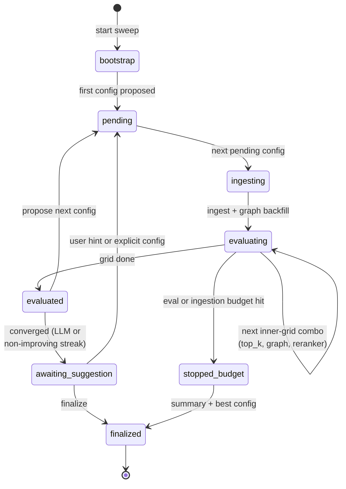

## 8. Sweep orchestration

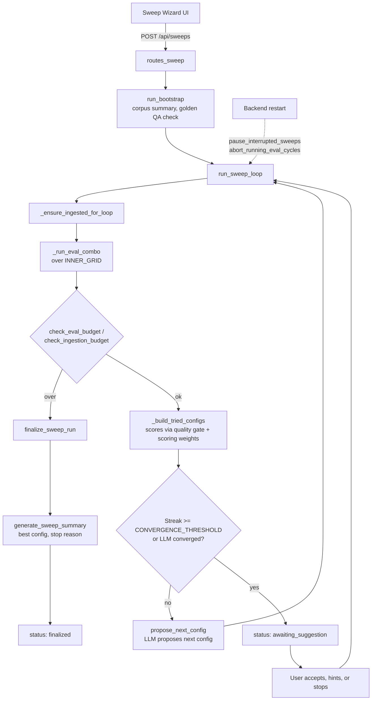

## 9. RCA agent

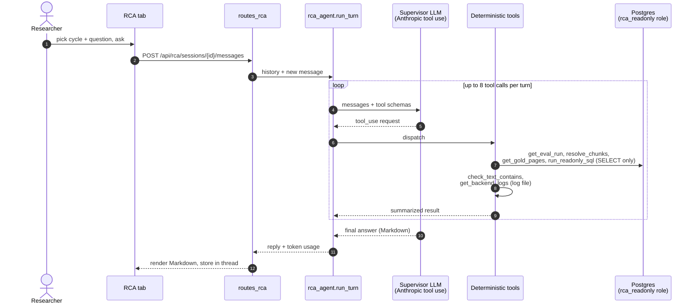

## 10. Model routing (opt-in)

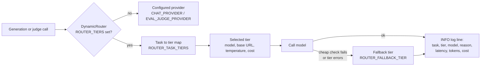

## 11. Ollama load balancer

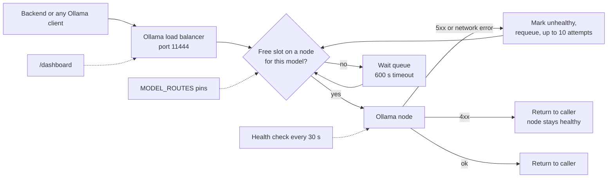
